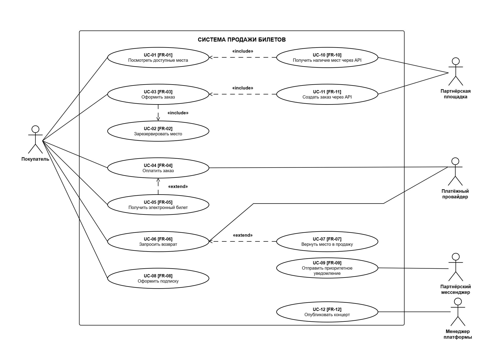

# Лабораторная работа №1. Формулирование требований к программной системе

| Поле | Значение |
|---|---|
| **Студент** | *Фокин А.В.* |
| **Группа** | *РИС-23-2* |
| **Вариант** | №5 |
| **Постановка задачи** | Сайт продажи билетов на концерты с большими выступлениями и большим объемом продаж нуждается в гибком решении для продажи билетов|
| **Репозиторий** | *https://github.com/Alexander-Risovsky/Proektirovanie-arxitekturi* |
| **Дата подготовки** | 21.11.2026 |

**Тема:** Анализ предметной области и формулирование требований к программной системе.

**Цель работы:** Научиться анализировать поставленную задачу, выделять заинтересованных лиц, формулировать функциональные и нефункциональные требования, представлять результаты в виде диаграммы вариантов использования.

---

## Краткое описание системы

Разрабатываемая система — онлайн-платформа продажи билетов на крупные концерты с отображением доступных мест, оформлением заказов, оплатой и возвратами. Ею пользуются покупатели, менеджеры билетного сервиса и внешние площадки-партнёры; при начале продаж ожидается до 10 000 запросов в секунду. Главная бизнес-задача — продавать билеты одновременно через несколько каналов без повторной продажи одного и того же места. Для повышения лояльности покупатели могут подписываться на интересующие концерты и получать приоритетные оповещения через партнёрский мессенджер.

**Границы системы:** управление афишей и местами, резервирование, оформление и оплата заказов, электронные билеты, возвраты, подписки, уведомления и интеграционный API. Организация концертов, физический контроль входа на площадке и банковская обработка карт остаются за пределами рассматриваемой системы.

**Особенности предметной области:** дефицит мест при старте продаж; высокая конкуренция за одно место; необходимость общего остатка для собственного сайта и партнёрских площадок; зависимость оплаты и уведомлений от внешних сервисов; ограничение возврата моментом начала мероприятия.

---

## Оглавление

1. [Перечень заинтересованных лиц](#1-перечень-заинтересованных-лиц-стейкхолдеров)
2. [Перечень функциональных требований](#2-перечень-функциональных-требований)
3. [Диаграмма вариантов использования](#3-диаграмма-вариантов-использования)
4. [Перечень нефункциональных требований](#4-перечень-нефункциональных-требований)
5. [Перечень сделанных предположений](#5-перечень-сделанных-предположений-повышенная-сложность)
6. [Чек-лист самопроверки](#6-чек-лист-самопроверки)

---

## 1. Перечень стейкхолдеров

| ID | Стейкхолдер | Роль | Интересы / цели | Влияние |
|---|---|---|---|---|
| **SH-01** | Покупатель | Основной пользователь сайта | 1. Купить конкретное свободное место без риска двойного списания или отмены из-за ошибки учёта. 2. Получать подходящие оповещения и возвращать билеты по правилам. | **Высокое:** массовые покупки формируют выручку; ошибки напрямую влияют на спрос и репутацию. |
| **SH-02** | Менеджер билетной платформы | Внутренний сотрудник, управляющий предложением | 1. Публиковать мероприятия со схемой зала и ценами. 2. Обеспечивать запуск продаж в заданное время и единые сведения о местах для каналов продаж. | **Высокое:** задаёт параметры продажи и отвечает за корректность опубликованной афиши. |
| **SH-03** | Партнёрская билетная площадка | Внешний канал продажи билетов | 1. Получать актуальные данные о наличии мест. 2. Создавать заказы через общую систему учёта без расхождения остатков. | **Среднее:** влияет на контракт и интерфейс интеграции, но не управляет продуктом напрямую. |
| **SH-04** | Платёжный провайдер | Внешний сервис проведения платежей и возвратов | 1. Получать корректные запросы на оплату и возврат. 2. Передавать подтверждённые результаты операций без дублирующей обработки. | **Высокое:** без подтверждения платежей невозможно корректно завершать покупки и возвраты. |
| **SH-05** | Партнёрский мессенджер | Внешний канал коммуникации с подписчиками | 1. Получать валидные задания на отправку сообщений. 2. Доставлять оповещения по согласованному формату и условиям интеграции. | **Среднее:** определяет возможности канала оповещений, но не является основным каналом продаж. |

---

## 2. Перечень функциональных требований

| ID | Требование | Стейкхолдер | Приоритет (MoSCoW) | Обоснование |
|---|---|---|---|---|
| **FR-01** | **Пользователь может** просматривать схему зала выбранного концерта с актуальным статусом каждого места: «свободно», «зарезервировано» или «продано». | SH-01, SH-02 | **Must** | Покупателю необходимо видеть остаток мест до оформления покупки. |
| **FR-02** | **Система должна** устанавливать для выбранного свободного места эксклюзивный резерв сроком на **10 минут**, не позволяя одновременно зарезервировать это место другому заказу. | SH-01, SH-03 | **Must** | Предотвращает конкурирующее оформление одного места в период высокого спроса. |
| **FR-03** | **Пользователь может** оформлять заказ на одно или несколько выбранных мест при наличии действующего резерва каждого из них. | SH-01 | **Must** | Фиксирует состав и стоимость покупки перед оплатой. |
| **FR-04** | **Пользователь может** оплачивать оформленный заказ через подключённого платёжного провайдера с получением подтверждённого статуса платежа. | SH-01, SH-04 | **Must** | Без подтверждения оплаты нельзя считать билет проданным. |
| **FR-05** | **Система должна** выдавать электронный билет с уникальным идентификатором после подтверждения успешной оплаты заказа. | SH-01 | **Must** | Покупатель получает подтверждение права посещения концерта. |
| **FR-06** | **Пользователь может** подать запрос на возврат оплаченного билета **строго до времени начала концерта**. | SH-01, SH-04 | **Must** | Соответствует заявленной политике возвратов. |
| **FR-07** | **Система должна** возвращать место в статус «свободно» после подтверждения успешного возврата билета, если концерт ещё не начался. | SH-01, SH-02, SH-04 | **Must** | Обеспечивает возможность повторной продажи возвращённого места. |
| **FR-08** | **Пользователь может** создавать подписку на информацию о концертах, задавая предпочтения по исполнителям, городам или жанрам. | SH-01 | **Must** | Персонализирует предложения и создаёт механизм клиентской лояльности. |
| **FR-09** | **Система должна** направлять соответствующим подписчикам приоритетные оповещения о старте продаж через интеграцию с партнёрским мессенджером. | SH-01, SH-05 | **Should** | Использует существующее партнёрство и повышает заинтересованность покупателей. |
| **FR-10** | **Система должна** предоставлять партнёрским площадкам API получения актуальных статусов мест для выбранного концерта. | SH-03 | **Should** | Позволяет внешним каналам показывать тот же остаток билетов. |
| **FR-11** | **Система должна** принимать от партнёрских площадок запросы на создание заказов через тот же механизм резервирования мест, что используется на основном сайте. | SH-03, SH-01 | **Should** | Исключает независимые остатки и повторную продажу через разные площадки. |
| **FR-12** | **Менеджер может** публиковать концерт, указывая дату и время события, начало продаж, схему мест и цены на билеты. | SH-02 | **Must** | Без описания мероприятия и его мест система не может начать продажу. |

---

## 3. Диаграмма вариантов использования

### Диаграмма

**Семантика связей:**

- `UC-03 → UC-02` — `<<include>>`: оформление заказа обязательно использует резервирование мест.
- `UC-11 → UC-03` — `<<include>>`: создание заказа партнёром использует общий механизм заказов.
- `UC-10 → UC-01` — `<<include>>`: запрос наличия через API использует общий учёт статусов мест.
- `UC-05 → UC-04` — `<<extend>>`: выдача билета происходит только после успешного подтверждения оплаты.
- `UC-07 → UC-06` — `<<extend>>`: возврат места в продажу выполняется после подтверждения возврата при условии, что концерт не начался.

### Описание ключевого сценария: покупка конкретного места

| Поле | Значение |
|---|---|
| **Use Case** | **UC-03 [FR-03] Оформление заказа**; связан с UC-02 [FR-02], UC-04 [FR-04], UC-05 [FR-05]. |
| **Основной актор** | Покупатель (SH-01). |
| **Вторичный актор** | Платёжный провайдер (SH-04). |
| **Предусловие** | Концерт опубликован; продажи открыты; выбранное место отображается как свободное. |
| **Основной поток** | **1.** Покупатель открывает схему мест (UC-01). **2.** Выбирает свободное место. **3.** Система атомарно устанавливает 10-минутный резерв (UC-02). **4.** Покупатель оформляет заказ на зарезервированное место (UC-03). **5.** Переходит к оплате (UC-04). **6.** Платёжный сервис подтверждает оплату. **7.** Система переводит место в статус «продано» и выпускает электронный билет (UC-05). |
| **Постусловие** | Существует один подтверждённый оплаченный заказ и один действительный билет для данного места; место больше не доступно к покупке. |
| **Альтернативный поток А** | Два покупателя одновременно выбирают одно место → резерв получает только один; второй видит отсутствие доступности и может выбрать другое место. |
| **Альтернативный поток Б** | Покупатель не оплатил заказ за 10 минут → резерв истекает, неоплаченный заказ не даёт права на билет, место возвращается в продажу. |
| **Альтернативный поток В** | Платёж отклонён → билет не выпускается; заказ получает статус «не оплачен», резерв действует до истечения своего срока. |
| **Альтернативный поток Г** | Провайдер повторно прислал подтверждение одного платежа → результат обрабатывается идемпотентно; второй билет не создаётся. |

### Дополнительный сценарий: возврат билета

1. Покупатель открывает оплаченный билет и отправляет запрос на возврат (**UC-06 [FR-06]**).
2. Система проверяет, что текущее время **раньше** времени начала выступления с учётом часового пояса площадки.
3. Возврат проводится через платёжного провайдера.
4. После успешного подтверждения система аннулирует билет и освобождает место (**UC-07 [FR-07]**).
5. Если выступление уже началось, запрос отклоняется. Если провайдер временно недоступен, билет остаётся в состоянии, исключающем ошибочную повторную продажу, до выяснения результата операции.

---

## 4. Перечень нефункциональных требований

Выбраны **пять** наиболее значимых характеристик: скорость обслуживания, масштабируемость, целостность данных о местах, безопасность платежей и доступность сервиса в период пиков. Удобство интерфейса и расширенная аналитика важны, но при ограниченном числе NFR уступают рискам двойной продажи и недоступности сервиса.

| ID | Категория | Требование | Метрика / критерий приёмки | Почему выбрано |
|---|---|---|---|---|
| **NFR-01** | **Performance** | Система должна быстро возвращать схему зала и состояние мест при пиковом спросе. | **p95 ≤ 1,5 с** для запросов просмотра мест при нагрузке **10 000 запросов/с** на протяжении 15 минут; ошибки сервера **< 1 %**. | Во время старта продаж тысячи пользователей постоянно проверяют свободные места. |
| **NFR-02** | **Scalability** | Система должна масштабироваться для кратковременных всплесков трафика без изменения бизнес-логики. | Нагрузочное испытание с ростом от **1 000 до 10 000 запросов/с**; после масштабирования выполняется NFR-01 при сохранении корректности NFR-03. | Заявлен резкий рост нагрузки при открытии продаж. |
| **NFR-03** | **Data integrity / Consistency** | Система должна гарантировать невозможность двух подтверждённых продаж одного места одного концерта, включая разные каналы продаж. | **0 двойных продаж** в тесте с **5 000 одновременных попыток** купить одно и то же место через сайт и API партнёра; повтор одного запроса/подтверждения не создаёт новый билет. | Это главное ограничение предметной области: двойная продажа приводит к конфликтам с покупателями. |
| **NFR-04** | **Security** | Система должна защищать личные данные и сведения об оплате. | Все внешние соединения — **HTTPS (TLS 1.2+)**; реквизиты банковских карт не хранятся в CMS билетного сервиса; перед релизом — **0 критических и высоких уязвимостей** по результатам проверки на OWASP Top 10. | В системе обрабатываются личные данные и инициируются денежные операции. |
| **NFR-05** | **Availability** | Система должна быть доступна во время активных продаж билетов. | Доступность **≥ 99,95 %** в месяц для публичного API и сайта, за исключением заранее согласованных окон обслуживания; в окно официального старта продаж плановые отключения **0 минут**. | Недоступность сервиса в момент старта продаж означает потерю выручки и доверия. |

**Примечание:** приведённые числовые пороги NFR-01–NFR-05 — проектные критерии приёмки, предложенные для лабораторной работы. Они отсутствуют в исходном описании и подлежат согласованию с заказчиком.

---

## 5. Перечень сделанных предположений

В постановке не указаны конкретные форматы билетов, условия интеграций, география продаж и детали пикового трафика. Для проверки требований приняты следующие **рабочие предположения**, которые не следует считать подтверждёнными бизнес-правилами.

| ID | Предположение | Влияние на требования |
|---|---|---|
| **A-01** | Рассматриваются концерты с **нумерованными местами**. Продажа билетов без закреплённого места не моделируется в этой итерации. | FR-01, FR-02, FR-07 и NFR-03 используют уникальный идентификатор места в рамках концерта. |
| **A-02** | Формулировка «всплеск до 10 000 в секунду» трактуется как **10 000 входящих HTTP-запросов/с**, а не 10 000 успешно оплаченных покупок/с. Проверочное окно пика — **15 минут**. | Определяет нагрузочные профили и числовые критерии NFR-01, NFR-02; требует подтверждения владельцем бизнеса. |
| **A-03** | Срок резерва — **10 минут** с момента его создания. Неоплаченный резерв автоматически истекает; резервирование во всех каналах использует общий источник истины о местах. | Конкретизирует FR-02, FR-03, FR-11; влияет на NFR-03 и конкурирующие транзакции. |
| **A-04** | Платёжные операции выполняет внешний провайдер; система получает результат по проверяемому уведомлению или запросу статуса, а повторная доставка обрабатывается идемпотентно. | Конкретизирует FR-04–FR-07; сокращает область ответственности по работе с картами, влияет на NFR-03, NFR-04. |
| **A-05** | Покупатели могут подписываться на исполнителей, жанры и города. «Приоритет» означает **раннее оповещение** подписчиков (например, за 15 минут до общего объявления), но **не эксклюзивное право** купить место. | Определяет предпочтения в FR-08 и порядок рассылки в FR-09; точное время требует согласования. |
| **A-06** | Партнёрские площадки работают через аутентифицированный API и не получают собственный независимый пул мест. | Определяет границы FR-10–FR-11, необходимость общей модели резервов и контроль доступа NFR-04. |
| **A-07** | Время концерта задаётся в **часовом поясе площадки**. Возврат допустим только до указанного времени начала. Полные коммерческие условия возврата задаются отдельно. | Обеспечивает однозначную проверку FR-06/FR-07 при продаже билетов в нескольких городах. |
| **A-08** | Электронный билет содержит уникальный номер/код. Проверка билета турникетом, офлайн-кассы и перепродажа билетов **не входят** в текущую модель. | Ограничивает область FR-05 и не добавляет неподтверждённые сценарии в диаграмму. |
| **A-09** | Интерфейс подготовки отчёта и демонстрационного прототипа — русский; страна размещения и применимое законодательство в условии **не определены**. | Локализация интерфейса задаётся как предположение, конкретные требования по хранению персональных данных уточняются после выбора юрисдикции (NFR-04). |

---

## 6. Чек-лист самопроверки

- [x] Постановка варианта описана; название варианта присутствует.
- [x] Перед сдачей заполнить **ФИО, группу, номер варианта (если предусмотрен), репозиторий**.
- [x] **5** заинтересованных сторон, включая внешние сервисы и партнёрскую площадку; влияние обосновано.
- [x] **12** функциональных требований, каждое с ID `FR-XX`, актором и приоритетом MoSCoW.
- [x] **12** вариантов использования, каждый связан с соответствующим `FR-XX`.
- [x] Есть отношения `<<include>>` и `<<extend>>`.
- [x] **5** измеримых нефункциональных требований с критериями приёмки.
- [x] Предположения вынесены отдельно и связаны с требованиями.
- [x] Исходник диаграммы `use-case.puml` подготовлен; изображение `use-case.png` встроено в отчёт.
- [x] Перед сдачей загрузить отчёт и исходник диаграммы в личный **GitHub/GitFlic**-репозиторий и добавить постановку варианта в `README.md`.

---
